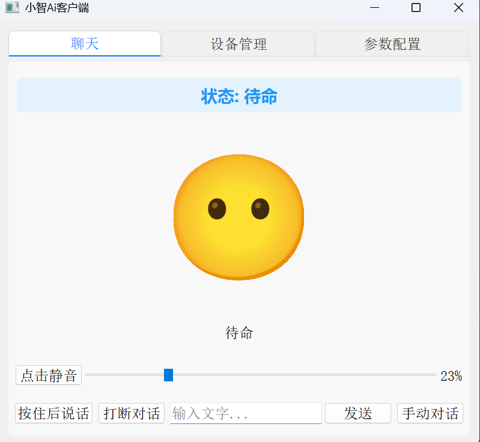

# Voice Interaction Modes



## Project Overview

py-xiaozhi is a Python-based AI voice assistant client built with a modern asynchronous architecture, supporting rich multimodal interaction features. The system integrates speech recognition, natural language processing, visual recognition, IoT device control, and other advanced technologies to deliver an intelligent interactive experience.

### Core Features

- **Multi-protocol Support**: WebSocket/MQTT dual-protocol communication
- **MCP Tool Ecosystem**: Integrated 10+ specialized tool modules
- **IoT Device Integration**: Thing-based architecture for device management
- **Visual Recognition**: GLM-4V-based multimodal understanding
- **Audio Processing**: Opus encoding + WebRTC enhancement
- **Global Shortcuts**: System-level interaction control

## Voice Interaction Modes

The system provides multiple voice interaction methods with flexible control and intelligent voice detection:

### 1. Manual Press Mode

- **How to use**: Hold the shortcut key to record, release to auto-send
- **Default shortcut**: `Ctrl+J` (configurable)
- **Use cases**: Precise control over recording duration, avoiding ambient noise interference
- **Advantages**:
  - Prevents accidental recording triggers
  - Full control over recording duration
  - Suitable for noisy environments

### 2. Turn-Based Conversation Mode (AUTO_STOP)

- **How to use**: Press the shortcut key / click the manual conversation mode toggle in the bottom-right of the GUI to switch to auto-conversation
- **Default shortcut**: `Ctrl+K` (configurable)
- **Use cases**: Quiet environments, traditional conversational interaction, when AEC is disabled
- **How it works**:
  - User speaks → AI replies → User speaks again
  - Each conversation turn waits for the AI to finish replying
  - Prevents echo and both sides speaking simultaneously
  - System automatically disables microphone input while the AI is speaking
- **Technical features**:
  - Default mode when AEC is disabled
  - Suitable for unidirectional audio devices or environments with echo issues
  - More stable conversation experience, avoiding audio conflicts

### 3. Real-Time Conversation Mode (REALTIME)

- **How to use**: Automatically activated when AEC echo cancellation is enabled
- **Configuration requirement**: `"AEC_OPTIONS.ENABLED": true`
- **Use cases**: Natural conversation, bidirectional interaction, complex environments, scenarios requiring the ability to interrupt the AI
- **AEC support**: Built-in WebRTC APM processes this application's playback reference; hardware AEC is not required. If the AEC engine is unavailable, the session falls back to `AUTO_STOP`. See [Echo Cancellation](./回声消除.md).

### 4. Wake Word Mode

- **How to use**: Speak the preset wake word to activate the system
- **Default wake words**: "小智", "小美" (customizable in configuration)
- **Model support**: Sherpa-ONNX offline keyword spotting
- **Configuration requirement**: Requires downloading the corresponding speech recognition model

### System State Management

The device states are `IDLE`, `LISTENING`, `SPEAKING` and `NOTIFYING`. Connection setup belongs to the protocol lifecycle. The diagram shows the main conversation and notification transitions:

```text
IDLE -- wake/button, connection and listen request succeed --> LISTENING
LISTENING -- TTS starts --> SPEAKING
SPEAKING -- playback drains, continue conversation --> LISTENING
SPEAKING -- playback drains, conversation ends --> IDLE
LISTENING -- stop/abort --> IDLE
IDLE -- server notification --> NOTIFYING
NOTIFYING -- notification finishes/cancels --> IDLE
```

A wake or user action can cancel a notification before starting a conversation.

## Run Modes and Deployment

### GUI Mode (Default)

Graphical user interface mode, providing an intuitive interactive experience:

```bash
# Standard launch
python main.py

# Using MQTT protocol
python main.py --protocol mqtt
```

**GUI Mode Features**:

- Visual operation interface
- Real-time status display
- Audio waveform visualization
- System tray support
- Graphical settings interface

### TUI Mode

Full-screen terminal interface built with Textual, suitable for interactive terminal sessions:

```bash
# Install the TUI extra
uv sync --extra tui
# Or: pip install -e '.[tui]'

# TUI mode launch
python main.py --mode tui

# TUI + MQTT protocol
python main.py --mode tui --protocol mqtt
```

**TUI Mode Features**:

- Terminal status and conversation display
- Text input and conversation controls
- Settings dialog and device selection
- No Qt dependency

Logs are written to the configured log files; console logging is disabled in TUI mode to preserve the terminal interface.

### GPIO Mode

GPIO button control mode, suitable for Raspberry Pi and other embedded devices:

```bash
# GPIO mode launch (Linux only)
python main.py --mode gpio

# GPIO + MQTT protocol
python main.py --mode gpio --protocol mqtt
```

**GPIO Mode Features**:

- Linux only (Raspberry Pi)
- Controlled via physical buttons
- No screen or keyboard required
- Suitable for embedded deployment

**Default Button Functions**:

| Button | GPIO Pin | Function               |
|--------|----------|------------------------|
| KEY1   | GPIO 17  | Start/Stop conversation |
| KEY2   | GPIO 27  | Interrupt current speech |
| KEY3   | GPIO 22  | Toggle manual/auto mode |
| KEY4   | GPIO 23  | Exit program           |

**Build Features**:

- Cross-platform support
- Single-file mode
- Dependency packaging
- Automated configuration

## Platform Compatibility

### Windows

- **Fully Compatible**: All features supported
- **Audio Enhancement**: Windows Audio API support
- **Volume Control**: Integrated pycaw volume management
- **System Tray**: Full tray functionality
- **Global Hotkeys**: Full shortcut key support

### macOS

- **Fully Compatible**: Core features fully supported
- **Status Bar**: Tray icon displayed in the top status bar
- **Permission Management**: May need to grant microphone/camera permissions
- **Shortcuts**: Some shortcuts require system permissions
- **Audio**: Native CoreAudio support

### Linux

- **Compatibility**: Supports mainstream distributions (Ubuntu/CentOS/Debian)
- **Desktop Environments**:
  - GNOME: Full support
  - KDE: Full support
  - Xfce: Requires additional tray support
- **Audio Systems**:
  - PulseAudio: Recommended (auto-detected)
  - ALSA: Fallback option
- **Dependencies**: May need to install system tray support packages

```bash
# Ubuntu/Debian tray support
sudo apt-get install libappindicator3-1

# CentOS/RHEL tray support
sudo yum install libappindicator-gtk3
```

## Troubleshooting Guide

### Common Issues

**1. Speech recognition not working**

- Use simple wake words like 小美, 小朋 for easier recognition

**2. Camera not working**

```bash
# Scan / test capture
python scripts/camera_scanner.py --test

# Linux / Raspberry Pi USB: device nodes and permissions
ls -l /dev/video*
sudo usermod -aG video $USER   # re-login required

# Official Pi CSI: system package (do NOT pip-install picamera2 on macOS)
sudo apt install -y python3-picamera2
rpicam-hello -t 1000
python scripts/camera_scanner.py --backend picamera2 --test
```

- Desktop: check OS camera permission and `CAMERA.camera_index`
- Pi: prefer `CAMERA.device` (e.g. `/dev/video0`) or `CAMERA.backend=picamera2`
- See [Camera Tools](../mcp/camera.md) / [Configuration - CAMERA](./配置说明.md#camera-configuration-camera)

**3. Shortcuts not responding**

- Check if other programs are occupying the same shortcuts
- Try running with administrator privileges (Windows)
- Check for system security software blocking

**4. Network connection issues**

- Check firewall settings
- Verify WebSocket/MQTT server addresses
- Test network connectivity
