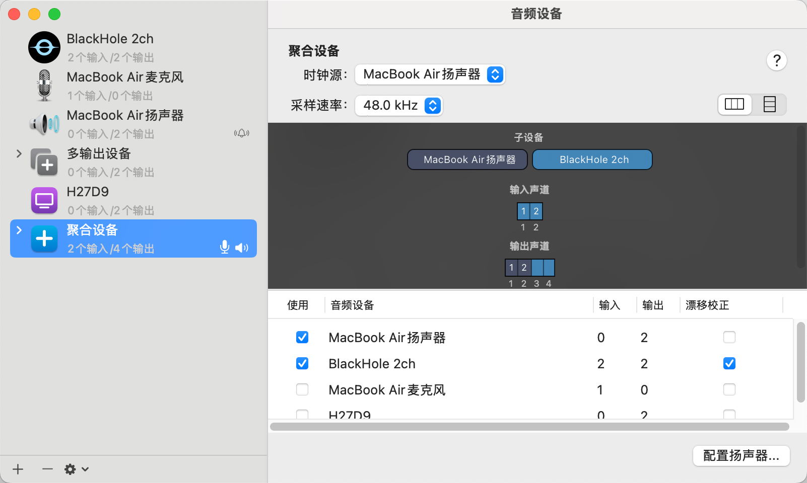
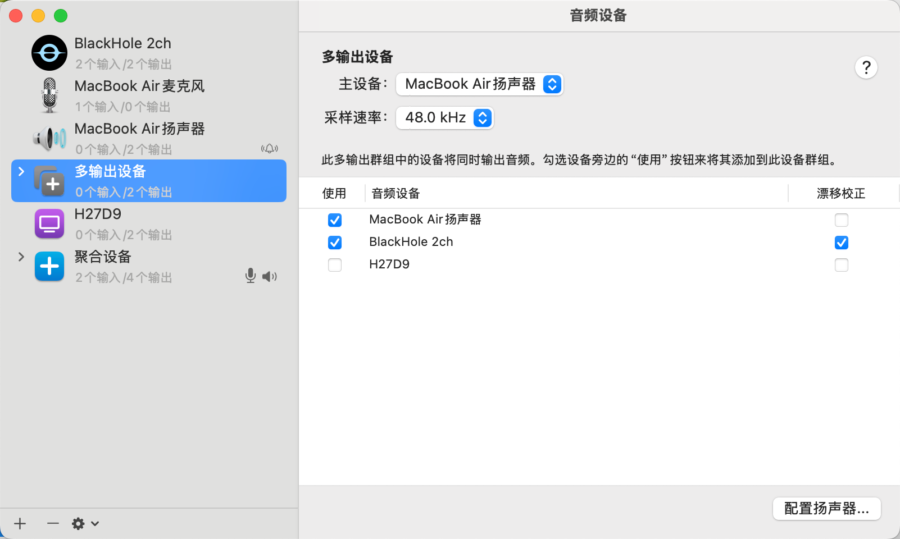
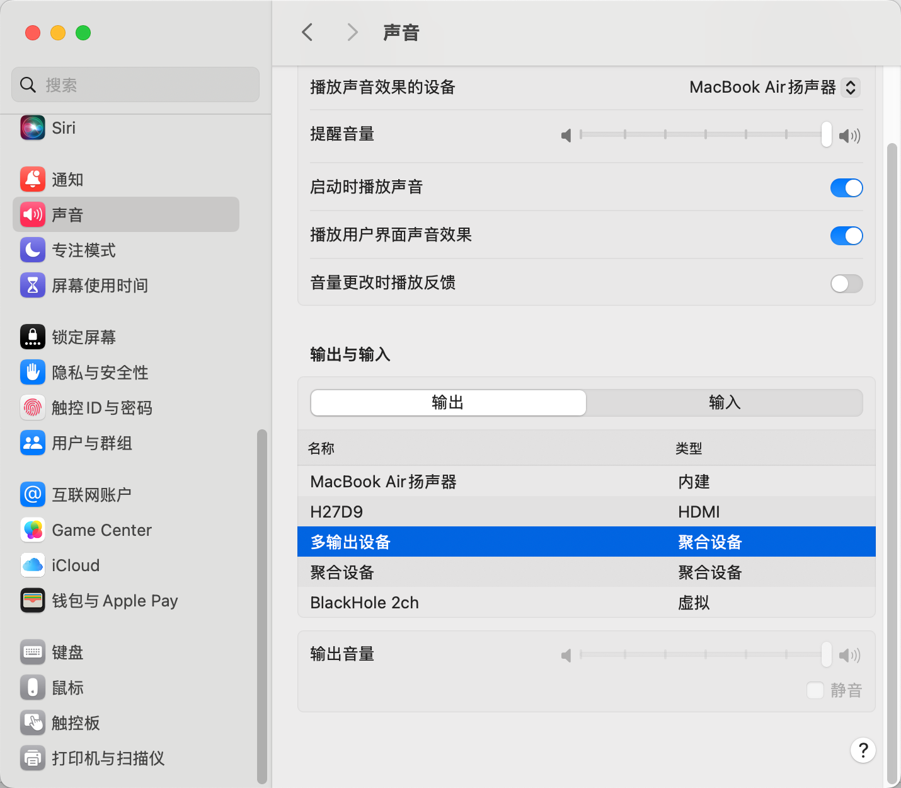

# Hướng dẫn cấu hình khử tiếng vọng (AEC)

## Tổng quan

Khử tiếng vọng âm học (Acoustic Echo Cancellation — AEC) là công nghệ cốt lõi trong tương tác giọng nói giúp loại bỏ nhiễu vọng do loa phát ra. Khi hệ thống phát âm thanh, micrô sẽ đồng thời thu lại âm thanh đó, làm giảm độ chính xác nhận diện giọng nói hoặc thậm chí gây ra hiện tượng "tự nói chuyện một mình" (AI nghe thấy chính giọng mình rồi tự trả lời).

**Nguyên lý hoạt động của AEC:**

- Thu tín hiệu âm thanh đầu vào từ micrô (gồm giọng người dùng + tiếng vọng)
- Lấy tín hiệu tham chiếu đang phát ra loa
- Dùng thuật toán trừ đi thành phần tiếng vọng dự đoán khỏi tín hiệu micrô
- Xuất ra tín hiệu giọng nói người dùng sạch

## AEC tích hợp sẵn (Mặc định, dùng ngay trên cả 3 hệ điều hành)

py-xiaozhi tích hợp sẵn WebRTC APM (`libs/webrtc_apm`, đi kèm thư viện động cho Windows/macOS/Linux), lấy **luồng trộn TTS / thông báo / media nền do chính ứng dụng phát ra** làm tín hiệu tham chiếu (Self far) để thực hiện khử tiếng vọng ngay trong ứng dụng — **không cần bất kỳ cấu hình hệ thống nào**.

```text
┌─────────────────┐                          ┌──────────────┐
│ Micrô vật lý    │──── Gần (có tiếng vọng) ▶│              │
└─────────────────┘                          │  WebRTC APM  │──▶ Giọng nói sạch ──▶ Nhận diện/Gửi lên
┌─────────────────┐                          │ (trong app)  │
│ Trộn TTS/media  │──── Tham chiếu xa ──────▶│              │
└────────┬────────┘                          └──────────────┘
         └────────▶ Phát ra loa
```

### Cách bật

Chỉnh sửa tệp cấu hình hoặc bật trong trang cài đặt GUI:

```json
{
  "AEC_OPTIONS": {
    "ENABLED": true,
    "MEDIA_PARALLEL": true,
    "FRAME_DELAY": 3,
    "ENABLE_PREPROCESS": true
  }
}
```

| Mục cấu hình        | Mô tả                                                                                                               |
| ------------------- | ------------------------------------------------------------------------------------------------------------------- |
| `ENABLED`           | Khi bật sẽ chuyển sang chế độ hội thoại thời gian thực (`REALTIME`), có thể ngắt lời AI bất cứ lúc nào              |
| `MEDIA_PARALLEL`    | Khi AEC hoạt động, phát song song TTS và media nền (tự động giảm âm lượng nền); khi AEC bị bỏ qua sẽ tạm dừng media |
| `FRAME_DELAY`       | Số khung bù trễ; mức bù thực tế = 40ms + N × độ dài khung giao thức                                                 |
| `ENABLE_PREPROCESS` | Lọc nhiễu / tiền xử lý lọc thông cao                                                                                |

Xem giải thích đầy đủ các mục cấu hình tại [Hướng dẫn cấu hình](./配置说明.md).

### Hành vi hệ thống

- **Tự động bỏ qua (Auto bypass)**: Nếu khởi tạo bộ xử lý AEC thất bại, hệ thống sẽ tự động bỏ qua mà không ảnh hưởng đến việc thu/phát âm thanh; khi ở trạng thái bỏ qua, phát media song song sẽ tự động chuyển về "tạm dừng media nền khi phát TTS và phát tiếp sau khi xong"
- **Chuyển nóng thiết bị**: Sau khi đổi thiết bị đầu vào/đầu ra, bộ xử lý AEC tự động khởi tạo lại mà không cần khởi động lại ứng dụng
- **Liên kết chế độ hội thoại**: `ENABLED: true` mặc định dùng hội thoại thời gian thực (`REALTIME`); `false` mặc định dùng hội thoại luân phiên (`AUTO_STOP`)

### Kiểm chứng hiệu quả

```text
1. Bật AEC rồi khởi động ứng dụng, chọn chế độ hội thoại tự động
2. Để AI phát câu TTS dài (hoặc phát nhạc nền qua plugin âm thanh mở rộng), sau đó nói trực tiếp để ngắt lời
3. Kết quả đạt yêu cầu: không tự nói chuyện một mình, ngắt lời trơn tru, nhận diện giọng nói không bị nhiễu khi media nền và TTS phát song song
```

Bạn cũng có thể kiểm tra trạng thái bộ xử lý trong mã nguồn:

```python
# Kiểm tra bộ xử lý AEC có đang hoạt động không
codec.aec_active  # True = đang hoạt động, False = chưa bật hoặc đã bỏ qua
```

### Hạn chế

AEC tích hợp chỉ lấy **nội dung âm thanh do chính ứng dụng phát ra** làm tín hiệu tham chiếu, do đó:

- ✅ Khử được: TTS, thông báo và âm thanh media do các plugin mở rộng phát qua `MediaPlayer` của py-xiaozhi
- ❌ Không khử được: âm thanh phát ra từ phần mềm khác (video trên trình duyệt, trình phát nhạc khác, v.v.)

Nếu cần khử âm thanh từ các phần mềm khác, bạn có thể dùng thêm các giải pháp cấp hệ thống bên dưới.

---

## AEC cấp hệ thống (Tăng cường tùy chọn)

Giải pháp cấp hệ thống thực hiện khử tiếng vọng ở tầng hệ điều hành, với tín hiệu tham chiếu bao phủ **toàn bộ âm thanh đầu ra của máy**, nhờ vậy có thể khử được cả âm thanh từ ứng dụng khác. Việc cấu hình phức tạp hơn một chút, hãy chọn dùng khi cần thiết.

### 🪟 Windows

- **Giải pháp**: AEC ở tầng trình điều khiển âm thanh (phần lớn thiết bị hỗ trợ sẵn)
- **Ghi chú**: Nhiều trình điều khiển card âm thanh / tai nghe đã tích hợp sẵn khử tiếng vọng, không cần cấu hình thêm

### 🐧 Linux (PulseAudio)

Sử dụng mô-đun `module-echo-cancel` để khử tiếng vọng ở cấp hệ thống:

```bash
# Script cấu hình tự động một bước
git clone https://github.com/W-E-A/PulseAudio-AEC-Script.git
cd PulseAudio-AEC-Script
chmod +x setup_aec.sh uninstall_aec.sh

# Chạy script cài đặt (KHÔNG dùng sudo)
./setup_aec.sh
```

Sau khi cấu hình xong, trong phần cài đặt "Âm thanh" (Sound) của hệ thống:

1. **Thiết bị đầu vào**: Chọn micrô ảo có chứa `echo cancellation`
2. **Thiết bị đầu ra**: Chọn loa ảo có chứa `echo cancellation`

> ⚠️ **Khuyến nghị phần cứng**: Tổ hợp micrô + loa tích hợp trên laptop có hiệu quả AEC hạn chế do rung động vật lý truyền trực tiếp giữa loa và mic; khuyến nghị dùng micrô USB rời + loa rời

Khắc phục lỗi thường gặp:

```bash
# Khi không tìm thấy thiết bị echo cancellation
pactl list sources short
pactl list sinks short
pulseaudio -k   # Khởi động lại dịch vụ âm thanh

# Kiểm tra trạng thái nạp mô-đun
pactl list modules | grep echo-cancel
```

Gỡ cài đặt: `./uninstall_aec.sh`

### 🍎 macOS (BlackHole)

Dùng thiết bị ảo BlackHole kết hợp Aggregate Device để định tuyến đầu ra hệ thống quay lại làm tín hiệu tham chiếu:

```bash
# Cài đặt BlackHole
brew install blackhole-2ch
```

1. Mở "Audio MIDI Setup" → "+" → "Create Aggregate Device" (thực tế một số máy cần tạo **Multi-Output Device** mới có hiệu lực)
   - ✅ Loa tích hợp (thiết bị chính)
   - ✅ BlackHole 2ch
   - Tần số mẫu: 48.0 kHz
2. Trong cài đặt "Sound" của hệ thống: chọn **Output** là thiết bị tổng hợp vừa tạo, giữ **Input** là micrô vật lý





> ⚠️ **Giới hạn điều chỉnh âm lượng**: Không thể chỉnh trực tiếp âm lượng hệ thống cho thiết bị tổng hợp; hãy chỉnh âm lượng từng thiết bị con trong Audio MIDI Setup

Kiểm tra thiết bị:

```bash
# Xác minh thiết bị BlackHole
system_profiler SPAudioDataType | grep -i blackhole

# Nếu không thấy thiết bị, cài lại và khởi động lại CoreAudio
brew reinstall blackhole-2ch
sudo launchctl kickstart -kp system/com.apple.audio.coreaudiod
```

---

## Khắc phục sự cố

**Q1: Đã bật AEC nhưng AI vẫn tự nói chuyện một mình**

- Xác nhận trong nhật ký không xuất hiện thông báo `"创建 AEC 引擎失败"` (khởi tạo bộ xử lý AEC thất bại) / `"AEC 未启用"` (AEC chưa được bật)
- Giảm âm lượng loa hoặc tăng khoảng cách giữa micrô và loa
- Tăng nhẹ `FRAME_DELAY` (nhất là khi dùng thiết bị Bluetooth có độ trễ cao)

**Q2: Hiệu quả kém với micrô tích hợp**

- Truyền rung động vật lý: độ rung từ loa truyền thẳng sang micrô tích hợp trong thân máy
- Khuyến nghị: dùng micrô USB rời + loa rời, hoặc đeo tai nghe (không có tiếng vọng vật lý)

**Q3: AI nghe thấy nhạc đang phát từ phần mềm khác**

- Đây là giới hạn đã biết của AEC tích hợp (tín hiệu tham chiếu chỉ lấy từ đầu ra của chính ứng dụng)
- Hãy dùng giải pháp cấp hệ thống ở trên hoặc tạm dừng phần mềm khác khi hội thoại

## Tài nguyên tham khảo

- [WebRTC Audio Processing](https://webrtc.googlesource.com/src/+/refs/heads/master/modules/audio_processing/) - Tài liệu triển khai thuật toán
- [PulseAudio AEC Script](https://github.com/W-E-A/PulseAudio-AEC-Script) - Script cấu hình AEC cấp hệ thống trên Linux
- [Kho lưu trữ chính thức BlackHole](https://github.com/ExistentialAudio/BlackHole) - Thiết bị âm thanh ảo cho macOS
