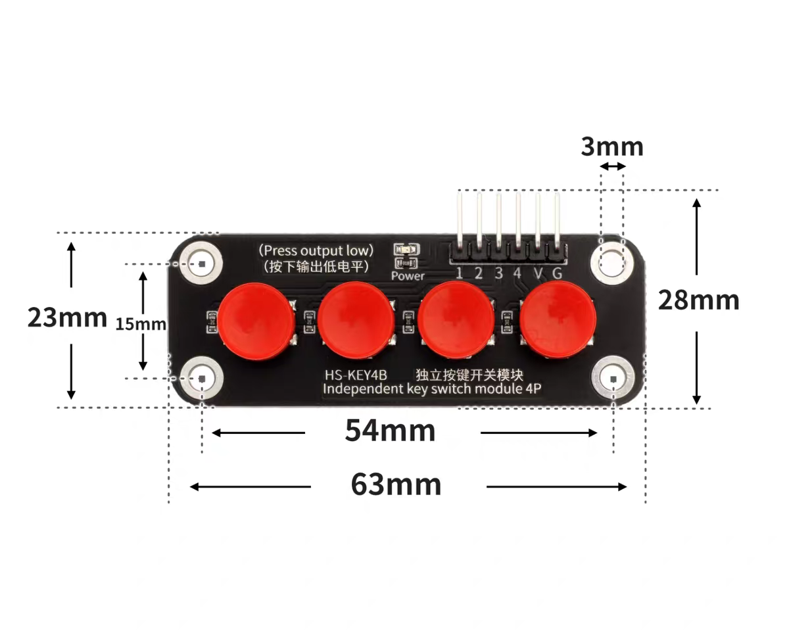
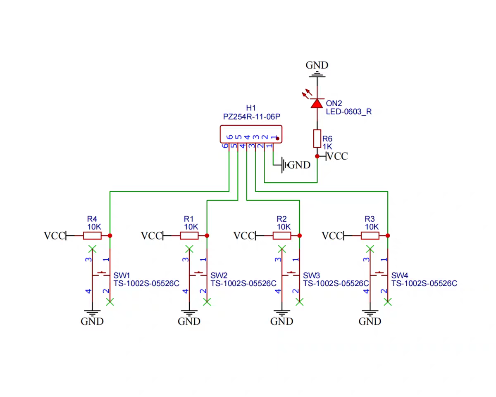
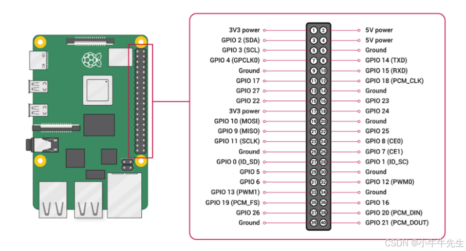
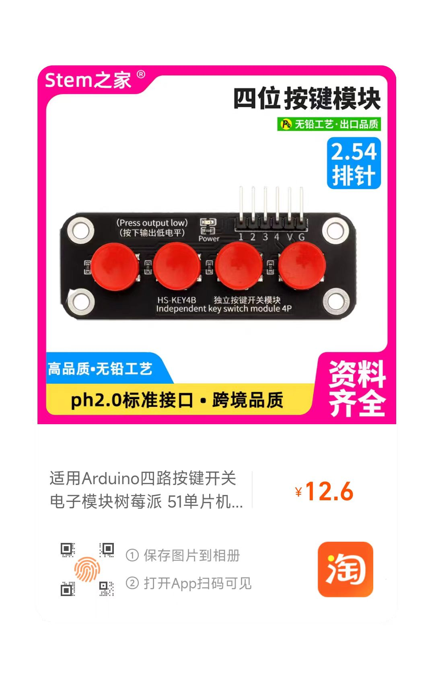

# Hướng dẫn phát triển mở rộng py-xiaozhi

> Tài liệu này dành cho các nhà phát triển muốn mở rộng tính năng, viết plugin hoặc tùy biến giao diện UI cho py-xiaozhi.

## Mục lục

- [Tổng quan kiến trúc dự án](#tong-quan-kien-truc-du-an)
- [Bắt đầu nhanh](#bat-đau-nhanh)
- [Đổi tên dự án](#đoi-ten-du-an)
- [Tùy chỉnh phát âm mã xác minh](#tuy-chinh-phat-am-ma-xac-minh)
- [Tùy chỉnh chân GPIO](#tuy-chinh-chan-gpio)
- [Phát triển plugin](#phat-trien-plugin)
- [Phát triển công cụ MCP](#phat-trien-cong-cu-mcp)
- [Phát triển trang UI](#phat-trien-trang-ui)
- [Giao tiếp qua EventBus](#giao-tiep-qua-eventbus)
- [Quản lý cấu hình](#quan-ly-cau-hinh)
- [Gỡ lỗi và kiểm thử](#go-loi-va-kiem-thu)
- [Thực hành tốt nhất](#thuc-hanh-tot-nhat)

---

## Tổng quan kiến trúc dự án

### Cấu trúc thư mục

```
py-xiaozhi/
├── main.py                 # Điểm khởi chạy ứng dụng
├── src/
│   ├── activation/         # Mô-đun kích hoạt thiết bị
│   ├── audio_codecs/       # Bộ giải mã âm thanh, bộ trộn đa rãnh AudioMixer, FFmpeg AudioDecoder
│   ├── audio_processing/   # Xử lý âm thanh (khử tiếng vọng WebRTC APM, từ khóa đánh thức, v.v.)
│   ├── bootstrap/          # Container dịch vụ và logic khởi động
│   │   ├── container.py    # Lõi ServiceContainer
│   │   └── protocols.py    # Giao thức giao diện plugin
│   ├── constants/          # Định nghĩa hằng số
│   ├── core/               # Các mô-đun cốt lõi
│   │   ├── event_bus.py    # Bus sự kiện (EventBus)
│   │   ├── state_manager.py# Trình quản lý trạng thái
│   │   └── task_manager.py # Trình quản lý tác vụ
│   ├── logging/            # Hệ thống nhật ký
│   ├── mcp/                # Hệ thống công cụ MCP
│   │   ├── mcp_server.py   # Máy chủ MCP
│   │   ├── tooling.py      # McpTool / Property
│   │   ├── plugins/        # Host plugin ngoài, trình cài đặt, RPC tiến trình con, MediaPlayerFacade
│   │   └── tools/          # Công cụ tích hợp sẵn (app / camera / media / screenshot / volume / weather)
│   ├── media/              # Nền tảng MediaPlayer dùng chung không phụ thuộc nguồn phát & TTS Audio Focus
│   ├── notifications/      # Phát trực tuyến thông báo một chiều từ máy chủ & đồng bộ phụ đề
│   ├── plugins/            # Hệ thống plugin
│   │   ├── base.py         # Lớp cơ sở của plugin
│   │   ├── manager.py      # Trình quản lý plugin
│   │   ├── audio.py        # Plugin âm thanh
│   │   ├── ui.py           # Plugin giao diện
│   │   ├── mcp.py          # Plugin MCP
│   │   └── wake_word.py    # Plugin từ khóa đánh thức
│   ├── protocols/          # Giao thức truyền thông
│   ├── ui/                 # Tầng giao diện người dùng
│   │   ├── tui/            # Giao diện terminal toàn màn hình Textual
│   │   ├── gui/            # Giao diện đồ họa
│   │   │   ├── manager.py  # ViewManager
│   │   │   ├── qml/        # Các tệp QML
│   │   │   └── services/   # Dịch vụ GUI
│   │   ├── gpio/           # Giao diện nút nhấn GPIO (chỉ Linux)
│   │   │   ├── manager.py  # GPIOViewManager
│   │   │   └── input.py    # Đầu vào nút nhấn GPIO
│   │   └── shared/         # Thành phần dùng chung
│   │       ├── bridge.py   # EventBridge
│   │       └── models/     # Mô hình dữ liệu
│   └── utils/              # Các lớp tiện ích
```

### Quan hệ giữa các thành phần cốt lõi

```
┌─────────────────────────────────────────────────────────┐
│                     ServiceContainer                     │
│  ┌─────────────┐  ┌─────────────┐  ┌─────────────────┐  │
│  │ TaskManager │  │StateManager │  │   EventBus      │  │
│  └─────────────┘  └─────────────┘  └─────────────────┘  │
│                           │                              │
│  ┌───────────────────────────────────────────────────┐  │
│  │                  PluginManager                     │  │
│  │  ┌────────┐ ┌────────┐ ┌────────┐ ┌────────────┐  │  │
│  │  │ Audio  │ │   UI   │ │  MCP   │ │  WakeWord  │  │  │
│  │  │ Plugin │ │ Plugin │ │ Plugin │ │   Plugin   │  │  │
│  │  └────────┘ └────────┘ └────────┘ └────────────┘  │  │
│  └───────────────────────────────────────────────────┘  │
└─────────────────────────────────────────────────────────┘
```

---

## Bắt đầu nhanh

### Chuẩn bị môi trường

```bash
# Nhân bản dự án
git clone https://github.com/your-repo/py-xiaozhi.git
cd py-xiaozhi

# Tạo môi trường ảo
python -m venv .venv
source .venv/bin/activate  # Linux/macOS
# hoặc .venv\Scripts\activate  # Windows

# Cài đặt GUI, TUI và các công cụ phát triển
uv sync --extra gui --extra tui --group dev
# hoặc sử dụng pip trong môi trường ảo ở trên:
# pip install -e '.[gui,tui]'
# pip install pytest pytest-asyncio ruff pyinstaller
```

### Chạy ứng dụng

```bash
# Chế độ GUI
python main.py --mode gui

# Chế độ TUI (terminal toàn màn hình)
python main.py --mode tui

# Bỏ qua quy trình kích hoạt (dùng khi gỡ lỗi)
python main.py --mode gui --skip-activation
```

---

## Đổi tên dự án

Nếu bạn cần đổi tên dự án (ví dụ khi phát triển phiên bản mở rộng), hãy sửa `APP_NAME` trong `src/constants/system.py`:

```python
# src/constants/system.py
class SystemConstants:
    APP_NAME = "my-xiaozhi"  # Đổi thành tên dự án của bạn
    APP_VERSION = "2.0.0"
    # ...
```

Ảnh hưởng sau khi thay đổi:
- Thư mục dữ liệu người dùng sẽ đổi thành `~/Library/Application Support/my-xiaozhi/` (trên macOS)
- Tệp cấu hình, bộ nhớ đệm, nhật ký, v.v. đều được lưu trong thư mục mới
- Dữ liệu giữa các dự án khác tên được cô lập hoàn toàn, không gây xung đột

> **Lưu ý**: Sau khi đổi tên dự án, cấu hình người dùng cũ sẽ không tự động di chuyển mà cần sao chép thủ công hoặc cấu hình lại.

---

## Tùy chỉnh phát âm mã xác minh

Khi kích hoạt thiết bị, hệ thống sẽ đọc to mã xác minh bằng các tệp âm thanh được thu sẵn. Tài nguyên âm thanh nằm trong thư mục `assets/sounds/`.

**Ngôn ngữ được hỗ trợ (37 ngôn ngữ)**:

```
assets/sounds/
├── zh-CN/          # Tiếng Trung giản thể (mặc định)
├── zh-TW/          # Tiếng Trung phồn thể
├── en-US/          # Tiếng Anh
├── ja-JP/          # Tiếng Nhật
├── ko-KR/          # Tiếng Hàn
├── de-DE/          # Tiếng Đức
├── fr-FR/          # Tiếng Pháp
├── es-ES/          # Tiếng Tây Ban Nha
├── ... (thêm ngôn ngữ khác)
└── vi-VN/          # Tiếng Việt
```

**Các tệp âm thanh có trong mỗi ngôn ngữ**:

| Tệp | Mô tả |
|------|------|
| `0.ogg` ~ `9.ogg` | Phát âm các chữ số từ 0 đến 9 |
| `activation.ogg` | Câu nhắc kích hoạt (ví dụ "Vui lòng nhập mã xác minh") |

**Đổi ngôn ngữ phát âm**:

Chỉnh sửa tham số `locale` trong `src/activation/service.py`:

```python
from src.utils.activation_announcer import announce_activation_code

# Phát âm bằng tiếng Anh
announce_activation_code(code, locale="en-US")

# Phát âm bằng tiếng Nhật
announce_activation_code(code, locale="ja-JP")
```

**Thay thế tệp âm thanh**:

1. Chuẩn bị các tệp âm thanh định dạng OGG mới (khuyến nghị tần số lấy mẫu 24kHz)
2. Thay thế các tệp trong thư mục ngôn ngữ tương ứng
3. Giữ nguyên chính xác tên tệp (`0.ogg` ~ `9.ogg`, `activation.ogg`)

**Thêm ngôn ngữ mới**:

1. Tạo thư mục ngôn ngữ mới trong `assets/sounds/` (ví dụ `my-lang/`)
2. Thêm đủ 11 tệp âm thanh OGG bắt buộc
3. Truyền locale mới khi gọi hàm: `announce_activation_code(code, locale="my-lang")`

---

## Tùy chỉnh chân GPIO

Chế độ GPIO chỉ hỗ trợ hệ điều hành Linux (Raspberry Pi), dùng để điều khiển thiết bị thông qua nút nhấn vật lý.

**Phần cứng khuyến nghị: Mô-đun 4 nút nhấn độc lập**





**Hướng dẫn đấu dây phần cứng**

Kết nối mô-đun nút nhấn 6Pin (`1 2 3 4 V G`) với Raspberry Pi 5:



**Đấu dây nguồn:**

| Chân mô-đun | Chân Raspberry Pi | Mô tả |
|----------|------------|------|
| V | 3.3V (Pin 1 hoặc Pin 17) | Cực dương nguồn |
| G | GND (Pin 6/9/14/20/25/30/34/39) | Cực âm nguồn, khuyến nghị Pin 6 |

> ⚠️ **Lưu ý**: Tuyệt đối không nối vào 5V (Pin 2/4), sẽ làm hỏng mô-đun!

**Đấu dây nút nhấn:**

| Chân mô-đun | GPIO (BCM) | Chân vật lý | Chức năng |
|----------|-------------|----------|------|
| 1 | GPIO 17 | Pin 11 | Bắt đầu/dừng hội thoại |
| 2 | GPIO 27 | Pin 13 | Ngắt giọng nói hiện tại |
| 3 | GPIO 22 | Pin 15 | Chuyển chế độ thủ công/tự động |
| 4 | GPIO 23 | Pin 16 | Thoát chương trình |

> Đặc tính mô-đun: khi nhấn xuất mức logic thấp (LOW), mã nguồn sử dụng đánh số BCM: `17/27/22/23`

**Thay đổi cấu hình chân**:

Chỉnh sửa `DEFAULT_PINS` trong `src/ui/gpio/input.py`:

```python
# src/ui/gpio/input.py

# Cấu hình chân GPIO mặc định (đánh số BCM)
# Tương ứng lần lượt với KEY1, KEY2, KEY3, KEY4
DEFAULT_PINS: List[int] = [17, 27, 22, 23]

# Sửa theo chân đấu dây thực tế của bạn, ví dụ:
# DEFAULT_PINS: List[int] = [5, 6, 13, 19]
```

**Cài đặt thư viện phụ thuộc**:

```bash
# Cài đặt thư viện gpiozero
sudo apt install python3-gpiozero python3-rpi.gpio

# Tùy chọn: cài thêm gói này nếu hệ thống hỗ trợ (gpiozero sẽ ưu tiên sử dụng)
sudo apt install -y python3-lgpio || true

# Thêm người dùng hiện tại vào nhóm gpio (tránh phải dùng sudo mỗi lần chạy)
sudo usermod -aG gpio $USER
# Đăng nhập lại hoặc khởi động lại để có hiệu lực
```

**Chạy chế độ GPIO**:

```bash
python main.py --mode gpio --protocol websocket
```

**Mua mô-đun nút nhấn**:




## Phát triển plugin

Plugin là cách cốt lõi để mở rộng chức năng của py-xiaozhi. Bằng cách kế thừa lớp cơ sở `Plugin`, bạn có thể:
- Phản hồi các sự kiện hệ thống (dữ liệu âm thanh, thông điệp JSON, thay đổi trạng thái, v.v.)
- Gọi các lệnh lõi (gửi âm thanh, bắt đầu lắng nghe, v.v.)
- Tương tác với các plugin khác

### Tạo plugin

Tạo tệp mới trong thư mục `src/plugins/`:

```python
# src/plugins/my_plugin.py

from typing import Any, TYPE_CHECKING
from src.plugins.base import Plugin
from src.logging import get_logger

if TYPE_CHECKING:
    from src.bootstrap.protocols import PluginCommands, PluginContext

logger = get_logger()


class MyPlugin(Plugin):
    """Plugin tùy chỉnh của tôi"""
    
    # Tên định danh duy nhất của plugin (bắt buộc)
    name = "my_plugin"
    
    # Độ ưu tiên: 1-100, giá trị càng nhỏ càng được khởi tạo sớm
    priority = 50
    
    # Các plugin phụ thuộc khác (tùy chọn)
    requires = ["audio"]  # Khai báo phụ thuộc vào AudioPlugin

    def __init__(self):
        super().__init__()
        self._my_state = None

    async def setup(self, ctx: "PluginContext", cmd: "PluginCommands") -> None:
        """Giai đoạn khởi tạo plugin
        
        Args:
            ctx: Ngữ cảnh plugin, dùng để đọc trạng thái (chỉ đọc)
            cmd: Giao diện lệnh plugin, dùng để thực thi thao tác
        """
        await super().setup(ctx, cmd)
        
        # Truy cập ngữ cảnh qua self.ctx
        config = self.ctx.get_config()
        
        # Truy cập plugin phụ thuộc qua self.deps
        audio_plugin = self.deps.get("audio")
        
        logger.info("MyPlugin khởi tạo hoàn tất")

    async def start(self) -> None:
        """Khởi động plugin (được gọi sau khi kết nối giao thức được thiết lập)"""
        await super().start()
        
        # Đăng ký lắng nghe sự kiện
        from src.core.event_bus import Events
        self.ctx.event_bus.on(Events.DEVICE_STATE_CHANGED, self._on_state_changed)
        
        logger.info("MyPlugin đã khởi động")

    async def on_protocol_connected(self, protocol: Any) -> None:
        """Thông báo sau khi kênh giao thức được thiết lập"""
        logger.info("Giao thức đã kết nối")

    async def on_incoming_json(self, message: Any) -> None:
        """Thông báo khi nhận được thông điệp JSON
        
        Args:
            message: Từ điển thông điệp JSON
        """
        if not isinstance(message, dict):
            return
            
        msg_type = message.get("type")
        if msg_type == "my_custom_type":
            # Xử lý thông điệp tùy chỉnh
            pass

    async def on_incoming_audio(self, data: bytes) -> None:
        """Thông báo khi nhận được dữ liệu âm thanh
        
        Args:
            data: Dữ liệu byte âm thanh thô
        """
        # Xử lý dữ liệu âm thanh
        pass

    async def on_device_state_changed(self, state: Any) -> None:
        """Thông báo khi trạng thái thiết bị thay đổi"""
        from src.constants.constants import DeviceState
        
        if state == DeviceState.LISTENING:
            logger.info("Thiết bị bắt đầu lắng nghe")
        elif state == DeviceState.SPEAKING:
            logger.info("Thiết bị đang nói")

    async def _on_state_changed(self, state):
        """Hàm xử lý sự kiện EventBus"""
        logger.debug(f"Thay đổi trạng thái: {state}")

    async def stop(self) -> None:
        """Dừng plugin"""
        await super().stop()
        logger.info("MyPlugin đã dừng")

    async def shutdown(self) -> None:
        """Dọn dẹp cuối cùng của plugin"""
        # Hủy đăng ký sự kiện
        from src.core.event_bus import Events
        self.ctx.event_bus.off(Events.DEVICE_STATE_CHANGED, self._on_state_changed)
        
        await super().shutdown()
        logger.info("MyPlugin đã dọn dẹp")
```

### Đăng ký plugin

Đăng ký plugin trong `src/bootstrap/container.py`:

```python
from src.plugins.my_plugin import MyPlugin

# Thêm vào phương thức _setup_plugins
self.plugins.register(
    AudioPlugin(),
    UIPlugin(mode=mode),
    McpPlugin(),
    WakeWordPlugin(),
    MyPlugin(),  # Thêm plugin của bạn
)
```

### Giao diện PluginContext

`PluginContext` cung cấp quyền truy cập chỉ đọc vào trạng thái hệ thống:

| Phương thức | Mô tả |
|------|------|
| `get_device_state()` | Lấy trạng thái thiết bị hiện tại |
| `get_listening_mode()` | Lấy chế độ lắng nghe hiện tại |
| `is_listening()` | Kiểm tra xem có đang lắng nghe không |
| `is_speaking()` | Kiểm tra xem có đang nói không |
| `is_idle()` | Kiểm tra xem có đang rảnh không |
| `is_audio_channel_opened()` | Kênh âm thanh đã được mở hay chưa |
| `should_capture_audio()` | Có nên thu âm thanh hay không |
| `get_config()` | Lấy trình quản lý cấu hình |
| `event_bus` | Lấy đối tượng bus sự kiện |

### Giao diện PluginCommands

`PluginCommands` cung cấp các phương thức thực thi thao tác:

| Phương thức | Mô tả |
|------|------|
| `start_listening(mode)` | Bắt đầu lắng nghe |
| `stop_listening()` | Dừng lắng nghe |
| `abort_speaking(reason)` | Ngắt quá trình nói |
| `send_audio(data)` | Gửi dữ liệu âm thanh |
| `send_text(text)` | Gửi văn bản |
| `send_wake_word_detected(text)` | Gửi sự kiện phát hiện từ khóa đánh thức |
| `send_mcp_message(payload)` | Gửi thông điệp MCP |
| `connect_protocol()` | Kết nối giao thức |
| `spawn(coro, name)` | Khởi tạo tác vụ bất đồng bộ |
| `request_shutdown()` | Yêu cầu đóng ứng dụng |

---

## Phát triển công cụ MCP

MCP (Model Context Protocol) là giao thức công cụ dùng để tương tác với mô hình AI. Các công cụ tích hợp sẵn được **đăng ký tường minh qua `register_*_tools(add_tool, …)`** và được gắn rõ ràng trong `McpServer.add_common_tools` / `McpPlugin.setup`; **không còn sử dụng** decorator `@mcp_tool` hay cơ chế tự động quét thư mục.

Xem hướng dẫn chi tiết và ví dụ đầy đủ tại [Hướng dẫn phát triển công cụ MCP](/vi/mcp/).

Đối với plugin mở rộng bên ngoài (nằm trong thư mục người dùng, tự mang theo gói phụ thuộc), xem [Tiện ích mở rộng MCP bên ngoài](/vi/mcp/plugins).

### Tạo công cụ MCP (tóm tắt)

Triển khai trong `src/mcp/tools/<name>/`:

```python
# src/mcp/tools/my_tools/register.py

from collections.abc import Callable
from typing import Any

from src.logging import get_logger
from src.mcp.tooling import McpTool, Property, PropertyList, PropertyType

logger = get_logger()


def register_my_tools(add_tool: Callable[[McpTool], None]) -> None:
    async def greet(args: dict[str, Any]) -> str:
        name = args.get("name", "bạn")
        return f"Xin chào, {name}! Rất vui được gặp bạn!"

    add_tool(
        McpTool(
            "my_tools.greet",
            "Chào hỏi người dùng. Gọi khi người dùng nói 'Xin chào', 'Hi'.",
            PropertyList([Property("name", PropertyType.STRING)]),
            greet,
        )
    )
    logger.info("Đã đăng ký my_tools")
```

```python
# src/mcp/tools/my_tools/__init__.py
from .register import register_my_tools
__all__ = ["register_my_tools"]
```

Gọi trong `mcp_server.add_common_tools` (hoặc `McpPlugin.setup`):

```python
from src.mcp.tools.my_tools import register_my_tools
register_my_tools(self.add_tool)
```

Khi cần đối tượng runtime như `MediaPlayer` / camera, hãy để container khởi tạo rồi truyền vào `register_*` dưới dạng tham số và giữ tham chiếu trong closure, **không** viết singleton ở cấp mô-đun.

### Kiểu thuộc tính

| PropertyType | Mô tả |
|--------------|------|
| `STRING` | Chuỗi ký tự |
| `INTEGER` | Số nguyên, tùy chọn `min_value` / `max_value` |
| `BOOLEAN` | Giá trị logic, tùy chọn `default_value` |

### Thực hành tốt khi viết mô tả công cụ

Trường `description` nên bao gồm: mô tả ngắn gọn, câu nói kích hoạt, hành vi và các điểm cần lưu ý, giúp mô hình AI chọn đúng thời điểm gọi công cụ.

---

## Phát triển trang UI

Giao diện GUI của py-xiaozhi sử dụng kiến trúc **PySide6 + QML (QtQuick)** theo mẫu MVVM.

### Mô tả kiến trúc

```
┌─────────────────────────────────────────────────────────┐
│                       QML (View)                         │
│  ┌─────────────┐  ┌─────────────┐  ┌─────────────────┐  │
│  │ MainWindow  │  │Settings    │  │ MyWindow        │  │
│  │    .qml     │  │ Window.qml │  │    .qml         │  │
│  └──────┬──────┘  └──────┬──────┘  └────────┬────────┘  │
│         │                │                   │           │
│         ▼                ▼                   ▼           │
│  ┌───────────────────────────────────────────────────┐  │
│  │               EventBridge (Signal/Slot)            │  │
│  └───────────────────────────────────────────────────┘  │
└─────────────────────────────────────────────────────────┘
                           │
                           ▼
┌─────────────────────────────────────────────────────────┐
│                    Python (ViewModel)                    │
│  ┌─────────────┐  ┌─────────────┐  ┌─────────────────┐  │
│  │ MainModel   │  │ Settings   │  │ MyModel          │  │
│  │             │  │ Model      │  │                  │  │
│  └─────────────┘  └─────────────┘  └─────────────────┘  │
└─────────────────────────────────────────────────────────┘
```

### Tạo trang mới

#### 1. Tạo tệp QML

```qml
// src/ui/gui/qml/windows/MyWindow.qml

import QtQuick
import QtQuick.Controls
import QtQuick.Layouts
import "../theme"
import "../components"

AppWindow {
    id: root
    
    width: 400
    height: 300
    minimumWidth: 300
    minimumHeight: 200
    title: "Cửa sổ của tôi"
    
    Rectangle {
        id: content
        anchors.fill: parent
        anchors.margins: root.isMaximized ? 0 : 1
        color: Theme.background
        
        ColumnLayout {
            anchors.fill: parent
            anchors.margins: Theme.spacingMd
            spacing: Theme.spacingMd
            
            // Tiêu đề
            Text {
                text: "Chào mừng sử dụng"
                font.pixelSize: Theme.fontSizeLg
                font.weight: Font.Bold
                color: Theme.textPrimary
            }
            
            // Ràng buộc dữ liệu động
            Text {
                text: myModel ? myModel.message : "Đang tải..."
                font.pixelSize: Theme.fontSizeMd
                color: Theme.textSecondary
                wrapMode: Text.WordWrap
                Layout.fillWidth: true
            }
            
            // Ô nhập liệu
            Rectangle {
                Layout.fillWidth: true
                Layout.preferredHeight: 40
                color: Theme.background
                radius: Theme.radiusMd
                border.color: inputField.activeFocus ? Theme.primary : Theme.border
                border.width: 1
                
                TextInput {
                    id: inputField
                    anchors.fill: parent
                    anchors.margins: 10
                    font.pixelSize: Theme.fontSizeMd
                    color: Theme.textPrimary
                    verticalAlignment: TextInput.AlignVCenter
                    
                    // Văn bản giữ chỗ
                    Text {
                        anchors.fill: parent
                        text: "Vui lòng nhập nội dung..."
                        font: parent.font
                        color: Theme.textPlaceholder
                        verticalAlignment: Text.AlignVCenter
                        visible: !parent.text && !parent.activeFocus
                    }
                }
            }
            
            // Nút bấm
            Button {
                id: actionBtn
                Layout.preferredWidth: 120
                Layout.preferredHeight: 40
                text: "Xác nhận"
                
                background: Rectangle {
                    color: actionBtn.pressed 
                        ? Theme.primaryPressed 
                        : (actionBtn.hovered ? Theme.primaryHover : Theme.primary)
                    radius: Theme.radiusMd
                }
                
                contentItem: Text {
                    text: actionBtn.text
                    font.pixelSize: Theme.fontSizeMd
                    color: "white"
                    horizontalAlignment: Text.AlignHCenter
                    verticalAlignment: Text.AlignVCenter
                }
                
                onClicked: {
                    if (eventBridge) {
                        eventBridge.onMyAction(inputField.text)
                    }
                }
            }
            
            // Lấp đầy khoảng trống còn lại
            Item { Layout.fillHeight: true }
        }
    }
}
```

#### 2. Tạo Python Model

```python
# src/ui/shared/models/my_model.py

from PySide6.QtCore import QObject, Property, Signal, Slot


class MyModel(QObject):
    """Mô hình dữ liệu cho cửa sổ của tôi"""
    
    # Định nghĩa tín hiệu
    messageChanged = Signal()
    dataListChanged = Signal()
    
    def __init__(self, parent=None):
        super().__init__(parent)
        self._message = "Hello World"
        self._data_list = []
    
    # ========== Thuộc tính message ==========
    def get_message(self) -> str:
        return self._message
    
    def set_message(self, value: str) -> None:
        if self._message != value:
            self._message = value
            self.messageChanged.emit()
    
    message = Property(str, get_message, set_message, notify=messageChanged)
    
    # ========== Thuộc tính dataList ==========
    def get_data_list(self) -> list:
        return self._data_list
    
    def set_data_list(self, value: list) -> None:
        self._data_list = value
        self.dataListChanged.emit()
    
    dataList = Property(list, get_data_list, set_data_list, notify=dataListChanged)
    
    # ========== Phương thức Slot (có thể gọi từ QML) ==========
    @Slot(str, result=bool)
    def validate_input(self, text: str) -> bool:
        """Kiểm tra hợp lệ đầu vào"""
        return len(text) > 0
    
    @Slot()
    def refresh(self) -> None:
        """Làm mới dữ liệu"""
        # Triển khai logic làm mới
        pass
```

#### 3. Mở rộng EventBridge

```python
# Thêm vào src/ui/shared/bridge.py

class EventBridge(QObject):
    # ... mã hiện có ...
    
    # Thêm tín hiệu mới
    myActionRequested = Signal(str)
    
    @Slot(str)
    def onMyAction(self, data: str) -> None:
        """Xử lý thao tác của tôi"""
        asyncio.create_task(
            self._event_bus.emit(Events.MY_CUSTOM_ACTION, {"data": data})
        )
```

#### 4. Đăng ký trong ViewManager

```python
# src/ui/gui/manager.py

from src.ui.shared.models.my_model import MyModel

class ViewManager(QObject):
    def __init__(self, event_bus: EventBus):
        # ... mã hiện có ...
        self._my_model = MyModel()
    
    def _inject_context(self):
        ctx = self._engine.rootContext()
        # ... mã hiện có ...
        ctx.setContextProperty("myModel", self._my_model)
    
    @property
    def my_model(self) -> MyModel:
        return self._my_model
```

### Biến chủ đề (Theme)

Trong QML, sử dụng đối tượng `Theme` để truy cập các biến giao diện:

#### Màu sắc

| Biến | Mô tả |
|------|------|
| **Bảng màu chính** | |
| `Theme.primary` | Màu chủ đạo `#165DFF` |
| `Theme.primaryHover` | Màu chủ đạo khi di chuột `#4080FF` |
| `Theme.primaryPressed` | Màu chủ đạo khi nhấn `#0E42D2` |
| `Theme.primaryLight` | Nền xanh nhạt `#E8F3FF` |
| `Theme.primaryText` | Chữ màu xanh `#2196F3` |
| **Màu chức năng** | |
| `Theme.success` | Màu thành công `#00B42A` |
| `Theme.successLight` | Nền nhạt thành công `#E8FFEA` |
| `Theme.successBorder` | Viền thành công `#B7EB8F` |
| `Theme.warning` | Màu cảnh báo `#FF7D00` |
| `Theme.warningLight` | Nền nhạt cảnh báo `#FFF7E8` |
| `Theme.warningBorder` | Viền cảnh báo `#FFE58F` |
| `Theme.error` | Màu lỗi `#F53F3F` |
| `Theme.errorHover` | Màu lỗi khi di chuột `#FF7875` |
| `Theme.errorLight` | Nền nhạt báo lỗi `#FFF2F0` |
| `Theme.errorBorder` | Viền báo lỗi `#FFCCC7` |
| **Màu nền** | |
| `Theme.background` | Màu nền chính `#FFFFFF` |
| `Theme.backgroundSecondary` | Màu nền phụ `#F7F8FA` |
| `Theme.backgroundHover` | Màu nền khi di chuột `#F2F3F5` |
| **Màu chữ** | |
| `Theme.textPrimary` | Màu chữ chính `#1D2129` |
| `Theme.textSecondary` | Màu chữ phụ `#4E5969` |
| `Theme.textPlaceholder` | Màu chữ giữ chỗ `#86909C` |
| **Viền & đường phân cách** | |
| `Theme.border` | Màu đường viền `#E5E6EB` |
| `Theme.divider` | Màu đường phân cách `#F2F3F5` |

#### Đổ bóng

| Biến | Mô tả |
|------|------|
| `Theme.shadowColor` | Màu bóng chính `#15000000` |
| `Theme.shadowLight` | Bóng nhẹ `#08000000` |
| `Theme.shadowMedium` | Bóng trung bình `#06000000` |
| `Theme.shadowSubtle` | Bóng mảnh `#04000000` |

#### Phông chữ

| Biến | Mô tả |
|------|------|
| `Theme.fontSizeXs` | Cỡ chữ siêu nhỏ (10px) |
| `Theme.fontSizeSm` | Cỡ chữ nhỏ (12px) |
| `Theme.fontSizeMd` | Cỡ chữ vừa (14px) |
| `Theme.fontSizeLg` | Cỡ chữ lớn (16px) |
| `Theme.fontSizeXl` | Cỡ chữ rất lớn (20px) |
| `Theme.fontSizeXxl` | Cỡ chữ cực lớn (24px) |
| `Theme.fontFamily` | Phông chữ hệ thống |
| `Theme.fontFamilyMono` | Phông chữ đơn cách (monospace) |

#### Khoảng cách

| Biến | Mô tả |
|------|------|
| `Theme.spacingXs` | Khoảng cách siêu nhỏ (4px) |
| `Theme.spacingSm` | Khoảng cách nhỏ (8px) |
| `Theme.spacingMd` | Khoảng cách vừa (12px) |
| `Theme.spacingLg` | Khoảng cách lớn (16px) |
| `Theme.spacingXl` | Khoảng cách rất lớn (20px) |
| `Theme.spacingXxl` | Khoảng cách cực lớn (24px) |

#### Bo góc

| Biến | Mô tả |
|------|------|
| `Theme.radiusSm` | Bo góc nhỏ (4px) |
| `Theme.radiusMd` | Bo góc vừa (8px) |
| `Theme.radiusLg` | Bo góc lớn (12px) |
| `Theme.radiusXl` | Bo góc rất lớn (16px) |

#### Hoạt ảnh

| Biến | Mô tả |
|------|------|
| `Theme.animationFast` | Hoạt ảnh nhanh (150ms) |
| `Theme.animationNormal` | Hoạt ảnh bình thường (200ms) |
| `Theme.animationSlow` | Hoạt ảnh chậm (300ms) |

---

## Giao tiếp qua EventBus

`EventBus` là cơ chế lõi giúp các thành phần giao tiếp với nhau một cách tách biệt (decoupled).

### Cách dùng cơ bản

```python
from src.core.event_bus import Events, EventBus

# Lấy đối tượng EventBus (thông qua ngữ cảnh plugin)
event_bus = self.ctx.event_bus

# Đăng ký lắng nghe sự kiện
async def my_handler(data):
    print(f"Nhận được dữ liệu: {data}")

event_bus.on(Events.DEVICE_STATE_CHANGED, my_handler)

# Sử dụng payload thay đổi trạng thái nhất quán với StateManager
state_change = {"old_state": old_state, "new_state": new_state}
await event_bus.emit(Events.DEVICE_STATE_CHANGED, state_change)

# Phát sự kiện tuần tự
await event_bus.emit_sequential(Events.DEVICE_STATE_CHANGED, state_change)

# Hủy đăng ký
event_bus.off(Events.DEVICE_STATE_CHANGED, my_handler)

# Xóa toàn bộ hàm xử lý
event_bus.clear(Events.DEVICE_STATE_CHANGED)
```

### Các sự kiện định nghĩa sẵn

```python
class Events:
    # Trạng thái thiết bị
    DEVICE_STATE_CHANGED = "device_state_changed"

    # Liên quan đến giao thức
    PROTOCOL_CONNECTED = "protocol_connected"
    PROTOCOL_DISCONNECTED = "protocol_disconnected"
    INCOMING_JSON = "incoming_json"
    SESSION_MESSAGE = "session_message"
    INCOMING_AUDIO = "incoming_audio"

    # Lỗi mạng
    NETWORK_ERROR = "network_error"

    # Vòng đời kênh âm thanh và bộ giải mã
    AUDIO_CHANNEL_OPENED = "audio_channel_opened"
    AUDIO_CHANNEL_CLOSED = "audio_channel_closed"
    AUDIO_CODEC_CHANGED = "audio_codec_changed"
    AUDIO_DEVICES_REFRESH_REQUEST = "audio_devices_refresh_request"

    # Thông báo cấp hệ thống
    SYSTEM_NOTICE = "system_notice"

    # Sự kiện trình phát media dùng chung
    MEDIA_STATE_CHANGED = "media_state_changed"
    MEDIA_SUBTITLE_UPDATE = "media_subtitle_update"

    # Phụ đề thông báo một chiều từ máy chủ
    NOTIFICATION_SUBTITLE = "notification_subtitle"

    # Thao tác người dùng trên UI (View → Plugin)
    UI_BUTTON_PRESS = "ui_button_press"
    UI_BUTTON_RELEASE = "ui_button_release"
    UI_MANUAL_TOGGLE = "ui_manual_toggle"
    UI_AUTO_TOGGLE = "ui_auto_toggle"
    UI_AUTO_START = "ui_auto_start"
    UI_ABORT_REQUEST = "ui_abort_request"
    UI_SEND_TEXT = "ui_send_text"
    UI_QUIT_REQUEST = "ui_quit_request"
    UI_TOGGLE_WINDOW = "ui_toggle_window"

    # Cấu hình và kết nối lại
    CONFIG_CHANGED = "config_changed"
    PROTOCOL_RECONNECT_REQUEST = "protocol_reconnect_request"
```

### Thêm sự kiện tùy chỉnh

```python
# src/core/event_bus.py

class Events:
    # ... các sự kiện hiện có ...
    
    # Thêm sự kiện tùy chỉnh
    MY_CUSTOM_EVENT = "my_custom_event"
    MY_DATA_UPDATED = "my_data_updated"
```

### Lớp dữ liệu sự kiện

Khuyến nghị tạo dataclass cho các dữ liệu sự kiện phức tạp:

```python
# src/my_module/events.py

from dataclasses import dataclass


@dataclass
class MyEventData:
    """Dữ liệu sự kiện của tôi"""
    id: str
    name: str
    value: int
    timestamp: float


# Cách sử dụng
await event_bus.emit(Events.MY_CUSTOM_EVENT, MyEventData(
    id="123",
    name="test",
    value=42,
    timestamp=time.time(),
))
```

---

## Quản lý cấu hình

Sử dụng `ConfigManager` để quản lý cấu hình ứng dụng.

### Đọc cấu hình

```python
from src.utils.config_manager import ConfigManager

from src.utils.config_manager import get_config

config = get_config()  # Điểm khởi chạy phải gọi initialize_config() trước

# Đọc mục cấu hình
value = config.get_config("SECTION.KEY", default_value)

# Ví dụ
aec_enabled = config.get_config("AEC_OPTIONS.ENABLED", True)
server_url = config.get_config("SERVER.URL", "ws://localhost:8080")
```

### Ghi cấu hình

```python
# Thiết lập mục cấu hình
config.set_config("SECTION.KEY", value)

# Lưu xuống tệp
config.save()
```

### Tải nóng cấu hình (Hot Reload)

Khi thay đổi cấu hình cần thông báo cho các thành phần khác:

```python
from src.core.event_bus import Events

# Phát sự kiện sau khi lưu cấu hình
config.save()
await self.ctx.event_bus.emit(Events.CONFIG_CHANGED, {
    "key": "SECTION.KEY",
    "value": new_value,
})
```

---

## Gỡ lỗi và kiểm thử

### Khởi chạy chế độ gỡ lỗi

```bash
# Bỏ qua quy trình kích hoạt
python main.py --mode gui --skip-activation

# Chế độ TUI (xem nhật ký tại tệp log đã cấu hình)
python main.py --mode tui --skip-activation
```

### Hệ thống nhật ký

```python
from src.logging import get_logger

logger = get_logger()

logger.debug("Thông tin gỡ lỗi")
logger.info("Thông tin chung")
logger.warning("Thông tin cảnh báo")
logger.error("Thông tin lỗi", exc_info=True)
```

### Kiểm thử đơn vị (Unit Test)

```python
# tests/test_my_plugin.py

import pytest
from unittest.mock import AsyncMock, MagicMock

from src.plugins.my_plugin import MyPlugin


class TestMyPlugin:
    @pytest.fixture
    def plugin(self):
        return MyPlugin()
    
    @pytest.fixture
    def mock_ctx(self):
        ctx = MagicMock()
        ctx.event_bus = MagicMock()
        ctx.get_config.return_value = MagicMock()
        return ctx
    
    @pytest.fixture
    def mock_cmd(self):
        return MagicMock()
    
    @pytest.mark.asyncio
    async def test_setup(self, plugin, mock_ctx, mock_cmd):
        await plugin.setup(mock_ctx, mock_cmd)
        assert plugin._ctx == mock_ctx
        assert plugin._cmd == mock_cmd
    
    @pytest.mark.asyncio
    async def test_on_incoming_json(self, plugin, mock_ctx, mock_cmd):
        await plugin.setup(mock_ctx, mock_cmd)
        
        message = {"type": "test", "data": "value"}
        await plugin.on_incoming_json(message)
        
        # Xác minh logic
```

---

## Thực hành tốt nhất

### 1. Phát triển plugin

- ✅ Dùng `requires` để khai báo phụ thuộc thay vì import trực tiếp plugin khác
- ✅ Dọn dẹp tài nguyên và hủy đăng ký sự kiện trong `shutdown()`
- ✅ Dùng `self.cmd.spawn()` để tạo tác vụ bất đồng bộ
- ❌ Không tham chiếu trực tiếp giữa các plugin, hãy giao tiếp qua `EventBus`

### 2. Công cụ MCP

- ✅ Viết `description` rõ ràng, nêu cụ thể tình huống kích hoạt
- ✅ Trả về chuỗi kết quả có ý nghĩa
- ✅ Bắt và xử lý ngoại lệ, trả về thông báo lỗi thân thiện
- ❌ Không thực hiện thao tác đồng bộ chặn luồng (blocking) kéo dài trong công cụ

### 3. Phát triển UI

- ✅ Sử dụng biến `Theme` để duy trì tính nhất quán trực quan
- ✅ `Model` chỉ lưu trạng thái, `View` chỉ xử lý hiển thị
- ✅ Giao tiếp QML ↔ Python thông qua `EventBridge`
- ❌ Không gọi trực tiếp logic nghiệp vụ Python từ trong QML

### 4. EventBus

- ✅ Sử dụng các hằng số định nghĩa sẵn trong `Events`
- ✅ Tạo dataclass cho dữ liệu phức tạp
- ✅ Hủy đăng ký sự kiện khi thành phần bị hủy
- ❌ Không tạo vòng lặp kích hoạt sự kiện

### 5. Lập trình bất đồng bộ

- ✅ Dùng `async/await` để xử lý các thao tác I/O
- ✅ Dùng `asyncio.gather()` để thực thi song song
- ✅ Thiết lập thời gian chờ (timeout) hợp lý
- ❌ Không gọi hàm đồng bộ gây chặn luồng bên trong hàm bất đồng bộ

---

## Tài liệu tham khảo

- [Tài liệu chính thức PySide6](https://doc.qt.io/qtforpython-6/)
- [Hướng dẫn nhập môn QML](https://doc.qt.io/qt-6/qmlapplications.html)
- [Đặc tả giao thức MCP](https://modelcontextprotocol.io/)
- [Tài liệu Python asyncio](https://docs.python.org/3/library/asyncio.html)

---

## Câu hỏi thường gặp

### Q: Thứ tự tải plugin không đúng thì xử lý thế nào?

Điều chỉnh giá trị `priority`, số càng nhỏ càng được ưu tiên cao. Bạn cũng có thể dùng `requires` để khai báo quan hệ phụ thuộc, `PluginManager` sẽ tự động sắp xếp topo (topological sort).

### Q: Công cụ MCP không có hiệu lực?

Hãy đảm bảo:
1. Gói có xuất `register_*_tools` (triển khai trong `register.py`) và được gọi tường minh trong `add_common_tools` / `McpPlugin.setup`
2. Thư mục có tệp `__init__.py` chứa `from .register import register_*_tools`
3. Tên công cụ là duy nhất trên toàn cục; khởi động lại ứng dụng và kiểm tra nhật ký đăng ký công cụ MCP
4. Luồng chạy chính thức đã gỡ bỏ `@mcp_tool` / tự động phát hiện, nên chỉ thêm tệp sẽ không tự động được nạp

### Q: Trong QML không truy cập được đối tượng Python?

Đảm bảo đối tượng đã được tiêm đúng cách trong `ViewManager._inject_context()`:
```python
ctx.setContextProperty("myModel", self._my_model)
```

### Q: Hàm xử lý sự kiện không được gọi?

1. Kiểm tra đã đăng ký đúng chưa: `event_bus.on(Events.xxx, handler)`
2. Đảm bảo hàm xử lý là hàm bất đồng bộ (`async def`)
3. Kiểm tra xem sự kiện có bị hủy đăng ký trước khi thành phần kết thúc không

---
