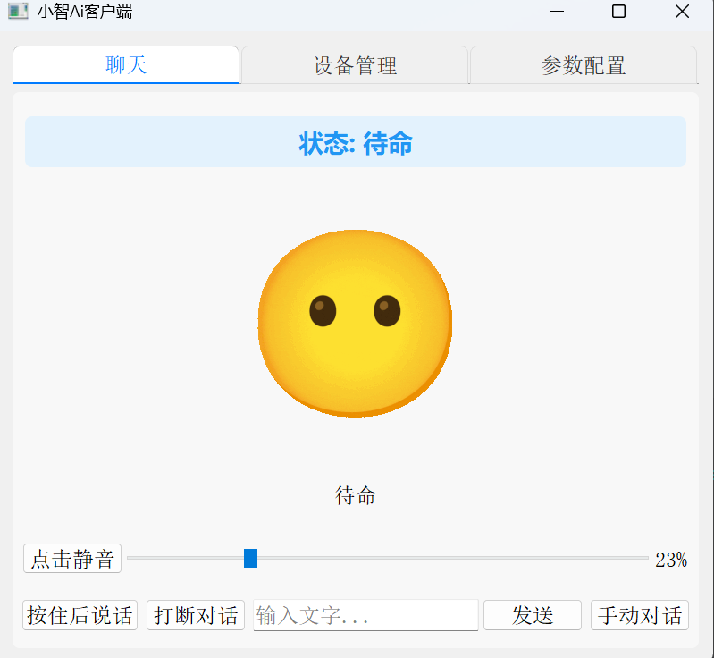

# Hướng dẫn chế độ tương tác giọng nói



## Tổng quan dự án

py-xiaozhi là ứng dụng trợ lý giọng nói AI phát triển bằng Python với kiến trúc bất đồng bộ hiện đại, hỗ trợ phong phú các tính năng tương tác đa phương thức. Hệ thống tích hợp nhận diện giọng nói, xử lý ngôn ngữ tự nhiên, nhận diện thị giác, điều khiển thiết bị IoT và nhiều công nghệ tiên tiến khác, mang lại trải nghiệm tương tác thông minh cho người dùng.

### Tính năng cốt lõi

- **Hỗ trợ đa giao thức**: Truyền thông song song qua WebSocket / MQTT
- **Hệ sinh thái công cụ & plugin MCP**: Tích hợp sẵn điều khiển âm lượng, ứng dụng, camera, chụp màn hình, thời tiết; hỗ trợ nhập plugin MCP mở rộng ngay trong trang cài đặt
- **Nền tảng phát media dùng chung**: Tích hợp `MediaPlayer` + `AudioMixer` độc lập với nguồn âm, giúp các plugin âm thanh mở rộng tái sử dụng ngay
- **Nhận diện thị giác**: Hỗ trợ hiểu nội dung đa phương thức từ camera (USB / Raspberry Pi CSI) và ảnh chụp màn hình máy tính
- **Xử lý âm thanh & khử tiếng vọng**: Mã hóa/giải mã Opus + WebRTC APM khử tiếng vọng tích hợp sẵn trên cả 3 hệ điều hành
- **Phím tắt toàn cục**: Điều khiển tương tác ở cấp hệ thống

## Các chế độ tương tác giọng nói

Hệ thống cung cấp nhiều phương thức tương tác giọng nói linh hoạt cùng khả năng phát hiện giọng nói thông minh:

### 1. Chế độ nhấn giữ thủ công

- **Cách thao tác**: Nhấn giữ phím tắt trong lúc nói để ghi âm, thả ra để tự động gửi
- **Phím tắt mặc định**: `Ctrl+J` (có thể tùy chỉnh trong cấu hình)
- **Tình huống phù hợp**: Kiểm soát chính xác thời lượng ghi âm, tránh nhiễu do tạp âm môi trường
- **Ưu điểm nổi bật**:
  - Tránh kích hoạt ghi âm nhầm
  - Chủ động hoàn toàn thời gian ghi âm
  - Phù hợp sử dụng trong môi trường ồn ào

### 2. Chế độ hội thoại luân phiên (AUTO_STOP)

- **Cách thao tác**: Nhấn phím tắt để bật/tắt hoặc nhấn nút chuyển chế độ thủ công/tự động ở góc dưới bên phải giao diện GUI
- **Phím tắt mặc định**: `Ctrl+K` (có thể tùy chỉnh trong cấu hình)
- **Tình huống phù hợp**: Môi trường yên tĩnh, hội thoại truyền thống, hoặc khi tắt tính năng AEC
- **Nguyên lý hoạt động**:
  - Người dùng nói → AI trả lời → Người dùng nói tiếp
  - Mỗi lượt hội thoại cần chờ AI trả lời xong
  - Tránh tiếng vọng và xung đột khi hai bên nói cùng lúc
  - Hệ thống tự động tắt thu âm micrô trong lúc AI đang nói
- **Đặc điểm kỹ thuật**:
  - Chế độ mặc định khi tắt AEC
  - Phù hợp thiết bị âm thanh một chiều hoặc môi trường dễ bị vọng âm
  - Trải nghiệm hội thoại ổn định, hạn chế xung đột âm thanh

### 3. Chế độ hội thoại thời gian thực (REALTIME)

- **Cách thao tác**: Tự động kích hoạt khi bật khử tiếng vọng AEC
- **Yêu cầu cấu hình**: `"AEC_OPTIONS.ENABLED": true`
- **Tình huống phù hợp**: Hội thoại tự nhiên, tương tác hai chiều, môi trường phức tạp, cần ngắt lời AI bất cứ lúc nào
- **Nền tảng kỹ thuật**: WebRTC APM tích hợp lấy âm thanh do chính ứng dụng phát ra làm tín hiệu tham chiếu khử vọng, không yêu cầu phần cứng âm thanh có sẵn AEC; nếu bộ xử lý không khả dụng, phiên hội thoại sẽ tự hạ về `AUTO_STOP`. Xem chi tiết cấu hình tại [Khử tiếng vọng](./回声消除.md)

### 4. Chế độ từ đánh thức

- **Cách thao tác**: Nói từ đánh thức đã thiết lập để kích hoạt hệ thống
- **Từ đánh thức mặc định**: "小智", "小美" (có thể tùy chỉnh trong cấu hình)
- **Hỗ trợ mô hình**: Nhận diện từ khóa ngoại tuyến dựa trên Sherpa-ONNX
- **Yêu cầu cấu hình**: Cần có tệp mô hình nhận diện giọng nói tương ứng

### Quản lý trạng thái hệ thống

Trạng thái thiết bị gồm `IDLE`, `LISTENING`, `SPEAKING` và `NOTIFYING`. Việc thiết lập kết nối thuộc vòng đời giao thức; dưới đây là luồng chuyển trạng thái hội thoại và thông báo chính:

```text
IDLE -- Đánh thức/nhấn nút, kết nối và gửi yêu cầu listen thành công --> LISTENING
LISTENING -- Nhận tín hiệu bắt đầu TTS --> SPEAKING
SPEAKING -- Phát xong, tiếp tục hội thoại --> LISTENING
SPEAKING -- Phát xong, không tiếp tục hội thoại --> IDLE
LISTENING -- Dừng/ngắt --> IDLE
IDLE -- Nhận thông báo từ máy chủ --> NOTIFYING
NOTIFYING -- Kết thúc/hủy thông báo --> IDLE
```

Khi có từ đánh thức hoặc thao tác từ người dùng, hệ thống có thể hủy thông báo trước rồi mới chuyển sang luồng hội thoại.

## Chế độ chạy và triển khai

### Chế độ GUI (Mặc định)

Chế độ giao diện đồ họa, mang lại trải nghiệm thao tác trực quan:

```bash
# Khởi động tiêu chuẩn
python main.py

# Sử dụng giao thức MQTT
python main.py --protocol mqtt
```

**Tính năng chế độ GUI**:

- Giao diện thao tác trực quan
- Hiển thị trạng thái theo thời gian thực
- Hiển thị dạng sóng âm thanh
- Hỗ trợ biểu tượng khay hệ thống (system tray)
- Giao diện cài đặt đồ họa

### Chế độ TUI

Giao diện terminal toàn màn hình dựa trên Textual, phù hợp cho phiên làm việc tương tác trên dòng lệnh:

```bash
# Cài đặt phụ thuộc tùy chọn cho TUI
uv sync --extra tui
# Hoặc: pip install -e '.[tui]'

# Khởi động chế độ TUI
python main.py --mode tui

# TUI + giao thức MQTT
python main.py --mode tui --protocol mqtt
```

**Tính năng chế độ TUI**:

- Hiển thị trạng thái và nội dung hội thoại ngay trên terminal
- Nhập văn bản và điều khiển hội thoại
- Hộp thoại cài đặt và chọn thiết bị
- Không phụ thuộc Qt

Nhật ký sẽ được ghi vào tệp log đã cấu hình; chế độ TUI tự tắt xuất nhật ký ra console để không làm rối giao diện terminal.

### Chế độ GPIO

Chế độ điều khiển bằng nút bấm GPIO, phù hợp cho thiết bị nhúng như Raspberry Pi:

```bash
# Khởi động chế độ GPIO (chỉ hỗ trợ Linux)
python main.py --mode gpio

# GPIO + giao thức MQTT
python main.py --mode gpio --protocol mqtt
```

**Tính năng chế độ GPIO**:

- Chỉ hỗ trợ hệ điều hành Linux (Raspberry Pi)
- Điều khiển bằng nút bấm vật lý
- Không cần màn hình và bàn phím
- Phù hợp triển khai thiết bị nhúng

**Chức năng nút bấm mặc định**:

| Nút bấm | Chân GPIO | Chức năng |
|---------|-----------|-----------|
| KEY1 | GPIO 17 | Bắt đầu/dừng hội thoại |
| KEY2 | GPIO 27 | Ngắt giọng nói hiện tại |
| KEY3 | GPIO 22 | Chuyển chế độ thủ công/tự động |
| KEY4 | GPIO 23 | Thoát chương trình |

**Đặc điểm đóng gói & triển khai**:

- Hỗ trợ đa nền tảng
- Chế độ tệp đơn (single-file)
- Đóng gói kèm phụ thuộc
- Cấu hình tự động hóa

## Khả năng tương thích nền tảng

### Nền tảng Windows

- **Tương thích hoàn toàn**: Hỗ trợ đầy đủ tất cả tính năng
- **Tăng cường âm thanh**: Hỗ trợ Windows Audio API
- **Điều khiển âm lượng**: Tích hợp quản lý âm lượng qua `pycaw`
- **Khay hệ thống**: Hỗ trợ đầy đủ tính năng system tray
- **Phím tắt toàn cục**: Hỗ trợ đầy đủ phím tắt

### Nền tảng macOS

- **Tương thích hoàn toàn**: Hỗ trợ đầy đủ các tính năng cốt lõi
- **Thanh trạng thái**: Biểu tượng khay hiển thị trên thanh menu phía trên
- **Quản lý quyền**: Có thể cần cấp quyền truy cập micrô/camera
- **Phím tắt**: Một số phím tắt cần cấp quyền hệ thống (Trợ năng / Accessibility)
- **Âm thanh**: Hỗ trợ CoreAudio gốc

### Nền tảng Linux

- **Khả năng tương thích**: Hỗ trợ các bản phân phối phổ biến (Ubuntu/CentOS/Debian)
- **Môi trường desktop**:
  - GNOME: Hỗ trợ đầy đủ
  - KDE: Hỗ trợ đầy đủ
  - Xfce: Cần cài thêm hỗ trợ khay hệ thống
- **Hệ thống âm thanh**:
  - PulseAudio: Khuyến nghị (tự động nhận diện)
  - ALSA: Phương án dự phòng
- **Phụ thuộc**: Có thể cần cài gói hỗ trợ khay hệ thống

```bash
# Hỗ trợ khay hệ thống trên Ubuntu/Debian
sudo apt-get install libappindicator3-1

# Hỗ trợ khay hệ thống trên CentOS/RHEL
sudo yum install libappindicator-gtk3
```

## Hướng dẫn khắc phục sự cố

### Các sự cố thường gặp

**1. Nhận diện giọng nói không hoạt động**

- Hãy thử các từ đánh thức dễ nhận diện hơn (như 小美, 小明)

**2. Không sử dụng được camera**

```bash
# Quét / chụp thử
python scripts/camera_scanner.py --test

# Linux / Raspberry Pi USB: kiểm tra nút thiết bị và quyền truy cập
ls -l /dev/video*
sudo usermod -aG video $USER   # Đăng nhập lại để có hiệu lực

# Raspberry Pi CSI chính hãng: dùng gói hệ thống (KHÔNG cài picamera2 bằng pip trên macOS)
sudo apt install -y python3-picamera2
rpicam-hello -t 1000
python scripts/camera_scanner.py --backend picamera2 --test
```

- Máy tính để bàn: kiểm tra quyền truy cập camera của hệ điều hành và `CAMERA.camera_index`
- Raspberry Pi: ưu tiên cấu hình `CAMERA.device` (như `/dev/video0`) hoặc `CAMERA.backend=picamera2`
- Xem chi tiết tại [Công cụ Camera](../mcp/camera.md) / [Hướng dẫn cấu hình - CAMERA](./配置说明.md)

**3. Phím tắt không phản hồi**

- Kiểm tra xem có ứng dụng khác đang chiếm cùng tổ hợp phím tắt không
- Thử chạy với quyền quản trị viên (Windows)
- Kiểm tra phần mềm bảo mật của hệ thống có chặn không

**4. Sự cố kết nối mạng**

- Kiểm tra cài đặt tường lửa
- Xác minh địa chỉ máy chủ WebSocket/MQTT
- Kiểm tra khả năng kết nối mạng
